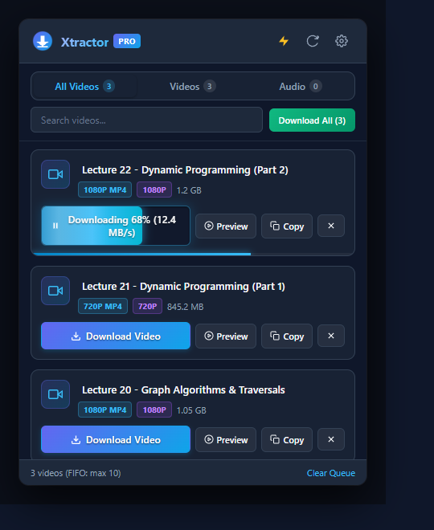

# Xtractor - Universal Video & Stream Downloader Extension

<p align="center">
  
</p>

**Xtractor** is a modern, high-performance browser extension (Manifest V3) inspired by tools like **Vidow** (`app.vidow.io` / Video Downloader Plus). It detects, sniffs, previews, and downloads video, audio, and adaptive HLS streams (`.m3u8`) across the web.

---

## 🚀 Key Features

* **Universal Media Detection**:
  * **Video**: MP4, WebM, MKV, MOV, FLV, AVI, etc.
  * **Audio**: MP3, AAC, WAV, M4A, OGG.
  * **Adaptive Streams**: HLS (`.m3u8`) and DASH (`.mpd`).
* **Multi-Layer Sniffing & Smart Deduplication**:
  * **Network Layer**: Passive header inspection via `chrome.webRequest` capturing direct CDN media URLs and streams.
  * **Page Context Interceptor**: Injected at `document_start` to intercept `window.fetch` and `XMLHttpRequest` calls from custom web players (Video.js, Hls.js, Plyr, JWPlayer, etc.).
  * **DOM & Mutation Observer**: Live inspection of `<video>`, `<audio>`, `<source>`, and dynamically mounted players (e.g. SPAs, infinite scroll feeds).
  * **Smart Deduplication Engine**: Automatically filters out duplicate MSE blob players, merges child variant stream chunks into master playlists, and maintains accurate 1:1 icon badge counters.
* **Persistent 10-Video FIFO Queue**:
  * Keep browsing across different pages and tabs while Xtractor stores detected videos in an indexed queue (up to 10 max).
  * **FIFO (First-In, First-Out)**: Once the queue reaches 10 items, the oldest video automatically drops off as new ones are discovered.
  * **Batch Download**: One-click **Download All (Queue)** button to sequentially fetch all queued videos.
  * **Individual Card Deletion**: Delete individual cards (✕) or clear the entire queue with a single click.
* **In-Popup Download Progress & Pause/Resume**:
  * Interactive progress bar rendered directly within the popup card.
  * **Single-Click Pause / Resume**: Click directly on the progress bar or its toggle button to pause and resume in-flight stream downloads instantly.
* **High-Performance In-Browser Transmuxing (Mediabunny)**:
  * Fast client-side transmuxing from raw MPEG-TS/HLS into standard, non-fragmented MP4 (`stss`/`moov` index tables).
  * Generates clean, stutter-free files with zero seeking lag across all native desktop players (VLC, QuickTime, Windows Media Player).
  * Harmless third-party metadata warning suppression (`stream_type 0x15`).
* **Integrated Stream Downloader Studio (HLS / M3U8)**:
  * Master Playlist parsing with quality variant selection (1080p, 720p, 480p, 360p, Audio-only).
  * Multi-threaded concurrent chunk fetcher (up to 8 parallel connections) with automatic retry logic.
  * Native AES-128 stream decryption using the browser's Web Crypto API.
  * Real-time download progress bar, speed meter (MB/s), ETA, and visual segment map.
* **Modern Dark-Mode Popup UI**:
  * Real-time media counter badge on extension icon.
  * Fully scrollable card container with wheel event fallback and stylish scrollbars.
  * In-popup video preview player with full playback controls.
  * Instant search and category filter tabs (All, Video, Streams, Audio).
  * Quick 1-click download and clipboard URL copying.
* **Configurable Preferences**:
  * Customizable minimum file size filter (suppresses ad clips and audio pings).
  * Custom download subfolder name.
  * Parallel connection tuning.

---

## 📦 How to Install (Chrome, Edge, Brave, Opera)

1. Open your browser and navigate to the extensions management page:
   * **Chrome / Brave**: `chrome://extensions`
   * **Microsoft Edge**: `edge://extensions`
2. Turn on **Developer mode** (toggle in the top-right or sidebar).
3. Click the **Load unpacked** button.
4. Select the project folder:
   ```
   C:\Users\deboj\projects\Xtractor
   ```
5. The **Xtractor** icon will appear in your browser extensions bar. Pin it to your toolbar for easy access!

---

## 🛠️ Usage Guide

### 1. Downloading Standard Videos (MP4, WebM, MP3)
1. Open any webpage with media content.
2. Play the video or scroll to let the player load.
3. The Xtractor badge on the extension icon will display the count of detected media files (e.g. `1`, `3`).
4. Click the Xtractor icon to open the popup:
   * Click **Preview** to watch the video directly inside the popup.
   * Click **Download** to trigger an instant browser download.
   * Click **Copy** to copy the raw media link.

### 2. Downloading HLS Streams (`.m3u8`) & In-Popup Downloads
1. When browsing a video stream that uses HLS, Xtractor will highlight it with a pink **M3U8 / Stream** badge.
2. Click **Download** directly on the card:
   * Watch the real-time download percentage and progress bar fill in right inside the popup.
   * Click the progress bar at any point to **Pause**, and click again to **Resume**.
   * Completed streams are transmuxed instantly into smooth, seeking-friendly `.mp4` files.
3. Alternatively, click **HLS Downloader** to open the full **Stream Studio** tab for advanced options:
   * Select your preferred resolution (e.g. 1080p, 720p).
   * Adjust parallel connections if desired.
   * Click **Start Stream Download & Merge**.

### 3. Queue & Batch Download
1. Browse across up to 10 lecture pages or video sites without closing or losing videos.
2. Open the popup to see your accumulated queue.
3. Remove any unwanted videos using the **✕** button on individual cards.
4. Click **Download All (Queue)** to download the entire list sequentially.

---

## 🧪 Testing the Extension

A built-in test sandbox is included:

1. **Option A (Direct File)**:
   * Double-click `test-page/test.html` or drag it into Chrome.
2. **Option B (Local Web Server)**:
   * Open a terminal in this directory and run:
     ```bash
     node test-page/test-server.js
     ```
   * Open `http://localhost:3000/` in your browser.
3. Test standard MP4 playback, MP3 audio, public HLS streams, and dynamically injected players.

---

## 📂 Project Architecture

```
Xtractor/
├── manifest.json              # Manifest V3 extension configuration
├── icons/                     # Crisp icons (16px, 32px, 48px, 128px)
├── assets/                    # Visual assets, previews, and mockups
│   ├── extension-preview.png  # Live extension popup screenshot
│   └── preview.html           # High-fidelity mock interface for asset generation
├── background/
│   └── service_worker.js      # Network sniffing, FIFO queue manager, tab media mapping
├── content/
│   ├── interceptor.js         # MAIN world fetch/XHR hook for streaming manifests
│   └── detector.js            # ISOLATED world DOM scanner & MutationObserver
├── popup/
│   ├── popup.html             # Modern popup UI with category tabs, search & FIFO footer
│   ├── popup.css              # Dark mode styling with glowing accents & constrained scroll
│   ├── popup.js               # Queue controller, pause/resume download, preview player
│   └── mediabunny.min.js      # Fast in-browser MP4 transmuxer (stss/moov seeking)
├── stream-downloader/
│   ├── downloader.html        # Full-page Stream Studio workspace
│   ├── downloader.css         # Stream Studio dashboard styling & segment map
│   ├── downloader.js          # Multi-worker chunk fetcher & progress engine
│   └── hls-parser.js          # M3U8 master/media parser & AES-128 decryptor
├── options/
│   ├── options.html           # Preferences page
│   ├── options.css            # Settings UI styling
│   └── options.js             # Storage synchronizer
├── test-page/
│   ├── test.html              # Multi-format media sandbox
│   └── test-server.js         # Local HTTP server for sandbox testing
└── README.md
```
